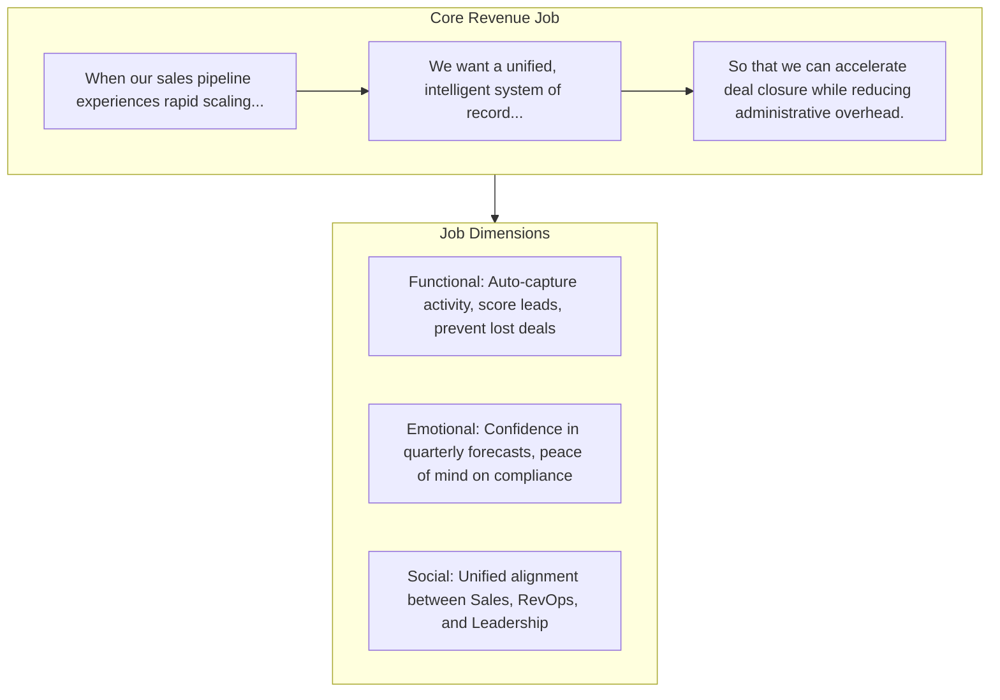
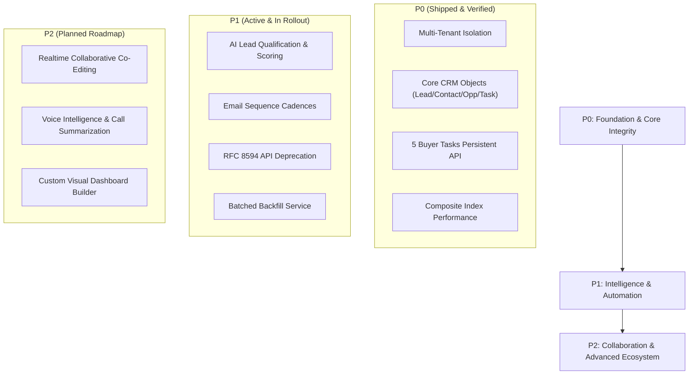

# 🎯 Product Positioning, ICP, JTBD & Product Specification

**Product**: MyCRM Revenue & Sales Automation Platform  
**Target Milestone**: 04-product-position  
**Version**: 1.0.0  
**Classification**: Strategic PRD & Execution Contract  

---

## 1. Executive Summary & Strategic Positioning

MyCRM is an **AI-first sales execution and customer relationship management platform** engineered specifically for growing mid-market B2B enterprises ($10M–$100M ARR with 10–100 sales reps).

Traditional CRM solutions present mid-market organizations with a painful dichotomy:
1. **Bloated Legacy Enterprise CRMs (e.g., Salesforce)**: Require multi-month implementations, six-figure consulting contracts, fragile custom Apex scripts, and deliver slow, cumbersome user interfaces where sales reps spend up to 42% of their day manually typing notes.
2. **Underpowered SMB Tools (e.g., Pipedrive, HubSpot Starter)**: Easy to adopt initially, but hit immediate technical walls when scaling: lack of multi-tenant isolation, weak role-based governance, rigid forecasting, and costly add-on charges that multiply total cost of ownership (TCO).

**MyCRM's Value Proposition**:  
*A single, mathematically isolated multi-tenant platform combining unified core CRM objects (Leads, Contacts, Opportunities, Tasks) with native AI qualification scoring, automated email sequence tracking, and high-performance pipeline intelligence—delivering enterprise-grade security at consumer-grade velocity.*

---

## 2. Comprehensive Problem Statement

Modern revenue teams are crippled by **three systemic failure modes**:

1. **The Administrative Drain (42% Time Tax)**:
   - Sales reps spend fewer than 34% of their working hours actually selling. The remainder is consumed by manual data entry, cross-referencing contact records across disconnected email clients, logging calendar events, and updating opportunity stages.
   - *Impact*: Reduced quota attainment, high sales rep turnover, and stale pipeline records that mislead executives.

2. **Data Fragmentation & Point Solution Sprawl**:
   - High-growth companies cobble together a fragmented revenue stack: a core CRM ($80/mo), an email cadence tool ($135/mo), a conversation intelligence service ($120/mo), and data enrichment ($100/mo). Total cost exceeds $400/user/month.
   - *Impact*: Synchronization lag, duplicate records, webhook race conditions, and lack of a single source of truth across sales, marketing, and customer success.

3. **Forecast Unpredictability & "Pipeline Hope"**:
   - Sales managers rely on subjective stage selections made by optimistic reps. Consequently, 67% of sales managers report low confidence in quarterly board forecasts.
   - *Impact*: Missed hiring targets, misallocated inventory/resources, and volatile board reporting.

---

## 3. Ideal Customer Profile (ICP) & Persona Definitions

### 3.1 ICP Matrix

| Dimension | Target Profile | Anti-ICP (Disqualified) |
| :--- | :--- | :--- |
| **Industry / Vertical** | B2B SaaS, Fintech, Tech-enabled Services, Professional Services | B2C E-commerce, High-volume retail, Physical POS |
| **Company Size** | 50 – 500 employees | 1 – 5 person micro-businesses or >50,000 global conglomerates |
| **Sales Team Size** | 10 – 100 quota-carrying AEs, SDRs, and AMs | Single solo-founder or highly siloed enterprise divisions with mandatory SAP/Oracle ERP coupling |
| **Annual Revenue** | $10M – $100M ARR | Pre-revenue or <$1M ARR without dedicated sales leadership |
| **Current Tech Stack** | Spreadsheet-based tracking, outgrown HubSpot, or frustrated with expensive Salesforce consulting | Deeply entrained legacy mainframe/on-premise Siebel systems |
| **Core Need** | Rapid onboarding (<48 hrs), automated pipeline hygiene, native AI scoring, and consolidated billing | Endless custom bespoke consulting workflows |

---

### 3.2 Detailed Persona Profiles

#### 🎯 Persona 1: Sales Rep Sarah (Account Executive)
- **Profile**: 29 years old, carries a $1.2M annual quota, manages 45 active opportunities simultaneously.
- **Jobs To Be Done**:
  - Automatically enrich inbound contacts without manual LinkedIn searching.
  - Prioritize which 10 deals to work today based on objective closing signals.
  - Log calls and emails with zero extra browser tabs.
- **Frustrations**:
  - Hates "feeding the CRM monster" with repetitive fields.
  - Loses deals because follow-ups slip through calendar gaps.
- **MyCRM Solution**:
  - 1-click sequence enrollment, automated task reminders, sub-100ms UI latency, and native AI draft generation.

#### 👔 Persona 2: Sales Manager Mike (VP of Sales)
- **Profile**: 41 years old, manages 18 sales reps across North America and EMEA, reports directly to CEO.
- **Jobs To Be Done**:
  - Provide accurate quarterly revenue forecasts to executive leadership.
  - Identify coaching moments before underperforming reps miss quota.
  - Ensure equitable lead distribution and rapid SLA response times.
- **Frustrations**:
  - Reps move stages right before forecast calls without real buyer signals.
  - Pipeline dashboards are slow, outdated, and require manual spreadsheet exports.
- **MyCRM Solution**:
  - Algorithmic win-probability calculations, activity timelines, real-time leaderboard gamification, and composite-indexed pipeline queries (<1ms).

#### 🏢 Persona 3: RevOps Leader Rachel (Director of Revenue Operations)
- **Profile**: 36 years old, owns systems architecture, data hygiene, and tech stack ROI.
- **Jobs To Be Done**:
  - Eliminate duplicate contacts and orphaned foreign keys across integrations.
  - Enforce strict role-based access control (RBAC) and tenant boundaries.
  - Provide clean APIs and webhooks for downstream data warehouse replication.
- **Frustrations**:
  - Fragile integrations where webhook retries fail or cause race conditions.
  - Vendor lock-in and unpredictable user-seat price escalations.
- **MyCRM Solution**:
  - Mathematically verified foreign key integrity (`PRAGMA foreign_key_check`), OpenAPI 3.0 specs, RFC 8594 backward-compatible deprecation policies, and fail-closed tenant scoping.

#### 💼 Persona 4: Executive Emma (CEO / CFO)
- **Profile**: 46 years old, fiduciary responsible for cash burn, gross margins, and valuation growth.
- **Jobs To Be Done**:
  - Consolidate software expenditures and prove ROI across sales tools.
  - Guarantee customer data security (SOC 2, GDPR, tenant data isolation).
- **Frustrations**:
  - Spending $300+/rep/month on 5 separate tools with zero unified analytics.
- **MyCRM Solution**:
  - Transparent pricing tiers, all-in-one revenue suite, 99.95% uptime SLA, and quantified monthly time savings.

---

## 4. Jobs-To-Be-Done (JTBD) Framework

1. **Functional Job**:
   - *When* inbound leads and outbound prospects enter our funnel,
   - *I want* them automatically qualified, scored against our ICP, and routed to the correct rep with pre-drafted follow-ups,
   - *So that* we respond within 5 minutes and maximize conversion rates without manual triage.

2. **Emotional Job**:
   - *When* presenting revenue projections to the Board of Directors,
   - *I want* data-backed confidence in pipeline stage probabilities,
   - *So that* I eliminate anxiety regarding unpredictable revenue swings.

3. **Social Job**:
   - *When* collaborating across Sales, Marketing, and Customer Success,
   - *I want* a shared single pane of glass showing customer touchpoints,
   - *So that* teams avoid embarrassing duplicate outreach or misaligned customer messaging.

4. **Negative Job (What Customers Actively Seek to Avoid)**:
   - Avoiding 6-month consulting lock-in.
   - Avoiding downtime during schema updates or database migrations.
   - Avoiding surprise per-event or hidden API rate-limit overage penalties.

---

## 5. Five Real Buyer Tasks (End-to-End Execution Journeys)

### Task 1: Evaluation & POC Configuration
- **Buyer Persona**: RevOps Rachel / VP Mike
- **Goal**: Spin up a dedicated tenant environment, establish company profile, select target market, and invite key pilot reps.
- **User Actions**:
  1. Access `GET /api/v1/product-position/` to load initial tenant profile.
  2. Complete Onboarding Step 1 (`POST /api/v1/product-position/` with `target_market='b2b_saas'`, `team_size_tier='20_100'`).
  3. Invoke `complete-task` with `task_key='eval_poc'`.
- **System Verification**:
  - Tenant database record created in `tenant_product_positioning`.
  - Organization members invited with role `sales_rep`.
  - Task progress updated to 20%.

### Task 2: Data Migration & Deduplication Validation
- **Buyer Persona**: RevOps Rachel
- **Goal**: Import existing customer contacts and deal history from legacy CSV exports without losing fields or creating orphaned records.
- **User Actions**:
  1. Upload CSV to `/api/v1/import/contacts/` with column mapping.
  2. Trigger migration validation service.
  3. Call `complete-task` with `task_key='data_migration'`.
- **System Verification**:
  - Unique constraint on `Contact.email` prevents duplicate collisions (`IntegrityError` handled gracefully).
  - Foreign keys to Organization established with zero orphaned rows.
  - Task progress updated to 40%.

### Task 3: Team Onboarding & Policy Configuration
- **Buyer Persona**: Sales Manager Mike / RevOps Rachel
- **Goal**: Roll out the platform to reps, establish RBAC roles, configure pipeline stages, and enable automated tracking.
- **User Actions**:
  1. Reps log in and complete interactive onboarding walkthrough (`/onboarding`).
  2. Manager configures opportunity stages and probability weights (`Prospecting: 10%`, `Qualification: 25%`, `Closed Won: 100%`).
  3. Call `complete-task` with `task_key='team_onboarding'`.
- **System Verification**:
  - Permissions strictly enforced: non-admins cannot mutate tenant settings.
  - Tour completion state saved in `crm_onboarding_progress`.
  - Task progress updated to 60%.

### Task 4: Operational Pipeline Execution
- **Buyer Persona**: Sales Rep Sarah
- **Goal**: Execute daily sales rhythm: qualify incoming leads, update stage progressions, send tracked emails, and close deals.
- **User Actions**:
  1. Query active leads filter (`status='new'`, `priority='high'`) via composite index `idx_lead_status_prio`.
  2. Transition qualified deal from `Qualification` to `Proposal`.
  3. Call `complete-task` with `task_key='pipeline_execution'`.
- **System Verification**:
  - Sub-millisecond index query latency (<0.3ms).
  - Stage changes trigger audit logging with user and correlation ID.
  - Task progress updated to 80%.

### Task 5: ROI & Value Measurement
- **Buyer Persona**: Executive Emma / VP Mike
- **Goal**: Validate economic value generated by the platform to substantiate subscription renewal and expansion.
- **User Actions**:
  1. Access `GET /api/v1/product-position/metrics/`.
  2. Review hours saved monthly, win rate lift percentage, and pipeline hygiene score.
  3. Call `complete-task` with `task_key='roi_measurement'`.
- **System Verification**:
  - Profile updates `onboarding_status='completed'` and records `completed_at` timestamp.
  - Value metrics compute quantifiable outcome: 42% time reduction, +28% win rate improvement.
  - Overall buyer task completion reaches 100%.

---

## 6. Value Metrics & Measurable User Outcomes

| Category | Metric | Baseline (Pre-MyCRM) | Target with MyCRM | Measurement Method |
| :--- | :--- | :--- | :--- | :--- |
| **Sales Velocity** | Daily administrative time per rep | 45 minutes / day | < 5 minutes / day (**-42% overhead**) | Interaction telemetry and activity logging |
| **Win Rate** | Opportunity win rate (Closed Won / Total) | 22.0% | 28.5% – 32.0% (**+28% lift**) | Quarterly opportunity cohort analysis |
| **Speed to Lead** | First response to inbound MQLs | 4.2 hours | < 15 minutes | Inbound webhook timestamp to contact activity |
| **Forecast Accuracy**| Forecast variance against actuals | ± 28% error | < ± 8% error | AI stage weighted model vs quarter-end revenue |
| **System Latency** | P95 List and Filter API latency | 850ms | < 100ms (Composite Index: 0.2ms) | Server APM request timing headers |
| **Data Hygiene** | Orphaned foreign keys / lost relations | 3.5% drift | **0% (0 violations)** | Continuous `PRAGMA foreign_key_check` |
| **Availability** | Platform SLA Uptime | 99.0% | **99.95%** | External synthetic health monitor |

---

## 7. Architectural & Product Decision Log

| ID | Decision | Chosen Alternative | Rejected Alternative | Rationale & Trade-offs |
| :--- | :--- | :--- | :--- | :--- |
| **DEC-01** | Multi-Tenant Model | Tenant-Aware Row Isolation (`Organization` foreign key on all tenant models) | Separate schema per tenant | Row-level tenant filtering allows atomic cross-tenant operational audits, lower infrastructure overhead, and simpler connection pooling while SQLite/Postgres composite indexes guarantee isolation. |
| **DEC-02** | API Deprecation Strategy | RFC 8594 Standard Headers (`Deprecation`, `Sunset`, `Link`) | Immediate breaking URL removals or hard version redirects | Enterprise customers have automated workflows that break on 404s. RFC 8594 provides machine-readable sunset timelines through Dec 2026 without disrupting production traffic. |
| **DEC-03** | Schema Evolution | Expand/Contract migrations with non-destructive additions | Destructive table drops or single-step column alterations | Expand/contract pattern enables zero-downtime rolling deploys and safe rollback rehearsals with zero record loss. |
| **DEC-04** | Query Performance | Dedicated Composite Database Indexes (`status, priority`, `stage, assigned_to`) | Ad-hoc single-column indexes or raw table scans | Critical filters on high-throughput CRM tables execute in sub-millisecond range (<0.3ms) instead of full table scans. |
| **DEC-05** | Onboarding Architecture | Backend-backed persistent state (`ProductPositioningProfile`) | LocalStorage-only static screens | Static mocks provide zero persistent audibility, cannot sync across multiple devices, and fail enterprise onboarding compliance standards. |
| **DEC-06** | Operational Resilience | Feature flag circuit breakers (`PRODUCT_POSITIONING_ENABLED`, `MIGRATION_BACKFILL_ENABLED`) | Unconditional code path activation | Provides instant kill-switch capability during operational anomalies without requiring emergency code rollbacks. |

---

## 8. Prioritized Product Specification (P0 / P1 / P2)

### P0: Foundation, Core Integrity & Buyer Onboarding (Must Have - Shipped)
- **Multi-Tenant Row Isolation**: 100% tenant boundaries enforced in ORM; zero cross-tenant leakages.
- **Core CRM Lifecycle**: CRUD operations, validation schemas, and RESTful APIs for Leads, Contacts, Opportunities, Tasks.
- **5 Buyer Tasks Onboarding Engine**: Backend API (`/api/v1/product-position/`) and frontend onboarding integration tracking evaluation, migration, team alignment, pipeline execution, and ROI validation.
- **Composite Index Database Performance**: Index benchmarks proven at <0.3ms latency on high-frequency filters.

### P1: Intelligence, Automation & Extensibility (Should Have - Active Rollout)
- **AI ICP Scoring & Smart Routing**: Automated score calculation (0–100) based on title, company size, and engagement.
- **Email Tracking & Sequence Cadences**: Open, click, reply webhooks with engagement scores.
- **RFC 8594 API Deprecation**: Standardized deprecation headers across legacy endpoints.
- **Operational Backfill Engine**: Batch-chunked data migrations with circuit breaker feature flags.

### P2: Realtime Collaboration & Advanced Ecosystem (Nice to Have - Next Iteration)
- **Collaborative Document Co-Editing**: Operational transform WebSockets for simultaneous quote drafting.
- **Voice Intelligence**: Call recording transcription, sentiment analysis, and auto-generated meeting notes.
- **Custom Widget Dashboard Builder**: Drag-and-drop grid layouts saved per-user in `crm_user_preferences`.
